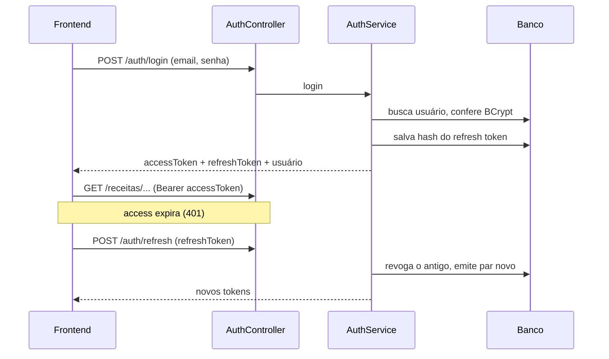

# Autenticação: JWT, refresh token e Spring Security

## 1. Visão geral

O login devolve **dois tokens**:

| Token | Formato | Vida | Onde fica no servidor |
|---|---|---|---|
| **Access token** | JWT assinado (HS256) | 15 min (`app.jwt.access-expiration-minutes`) | Em lugar nenhum (é *stateless*) |
| **Refresh token** | 32 bytes aleatórios (opaco) | 7 dias (`app.jwt.refresh-expiration-days`) | Tabela `refresh_token`, **só o hash SHA-256** |

## 2. Classes

| Classe | Papel |
|---|---|
| `JwtService` | Gera e valida o access token. Exige `app.jwt.secret` com 32+ caracteres |
| `JwtAuthFilter` | Roda a cada requisição, lê `Authorization: Bearer ...` e autentica |
| `SecurityConfig` | Regras de acesso por rota, CSRF, sessão, 401 |
| `AuthService` | `login`, `refresh`, `logout` |
| `RefreshToken` / `RefreshTokenRepository` | Persistência das sessões |

## 3. O filtro (`JwtAuthFilter`)

1. Lê o header `Authorization`.
2. `JwtService.validar` confere **assinatura e validade**.
3. Consulta o banco: o usuário **ainda existe** e a **senha não foi trocada depois** que o token foi emitido (`senhaAlteradaEm`).
4. Se tudo ok, grava o id do usuário no `SecurityContext`.
5. Se não, segue sem autenticar. O `SecurityFilterChain` responde `401` nas rotas protegidas.

O id do usuário vem **sempre do token**, nunca do corpo da requisição (evita IDOR).

## 4. Regras de rota (`SecurityConfig`)

- `/auth/**`: público.
- `GET /receitas`, `/receitas/*`, `/ingredientes`, diretório de chefs, nutricionistas e restaurantes, `GET /imagens/*`: **públicos** (só leitura).
- `/chefs/me`, `/nutricionistas/me`, `/restaurantes/me`: exigem login. Ficam **antes** das rotas públicas, senão `/chefs/me` seria lido como `/chefs/{id}`.
- Qualquer outra: `authenticated()`.
- `csrf` desligado (não usamos cookie de sessão), sessão `STATELESS`.
- Sem token: `401` com JSON `{"status":401,"mensagem":"Não autenticado"}` (o padrão seria 403).

## 5. Refresh token com rotação

- Cada `refresh` **revoga** o token usado e emite um novo par.
- Se um token **já revogado** é apresentado de novo, é sinal de roubo: `revogarTodosDoUsuario` derruba todas as sessões.
- `@Transactional(noRollbackFor = TokenInvalidoException.class)`: a revogação precisa ser confirmada **mesmo** lançando a exceção.
- O banco guarda só o **hash**. Se vazar, os tokens não servem.
- `logout` é idempotente: token desconhecido não gera erro.

## 6. Login e enumeração de emails

Quando o email não existe, o `AuthService` compara a senha com um **hash falso**. O tempo de resposta fica parecido nos dois casos, e a resposta é sempre `CredenciaisInvalidasException`. Assim não dá para descobrir quais emails têm conta.

## 7. Senhas

BCrypt, bean único em `SecurityConfig`. Detalhes em [Service](Service.md).

## 8. Decisões e trade-offs

- **Sem papéis (roles) de acesso.** O `role` de `Profissional` é só discriminador de tipo, não permissão.
- **Access curto + refresh longo:** limita o estrago se o access vazar.
- **Consulta ao banco a cada requisição** no filtro: custa uma query, mas permite invalidar tokens após troca de senha.

## 9. Erros comuns

- `JWT_SECRET` ausente ou com menos de 32 caracteres: a API não sobe.
- Esquecer o `Bearer ` no header.
- Colocar rota privada depois de um `permitAll` mais amplo.
- Guardar o refresh token puro no banco.

## 10. Perguntas de consolidação

1. Por que o refresh token é opaco e o access é JWT?
2. O que acontece se um refresh token revogado for reutilizado?
3. Por que o filtro consulta o banco mesmo com assinatura válida?
4. Por que `/chefs/me` vem antes de `/chefs/*`?
