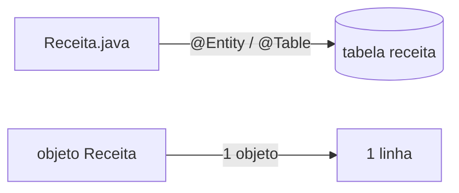
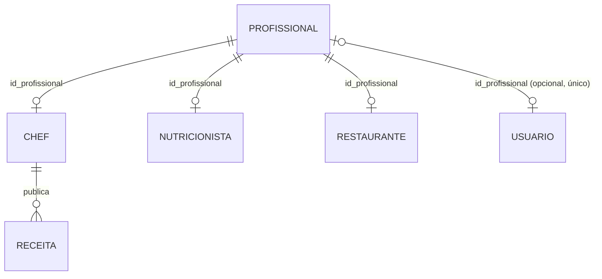

# Entity (JPA): como as tabelas viram classes

## 1. O que é uma entidade

Uma **entidade** é uma classe Java mapeada para uma tabela do banco. Cada objeto é uma linha. No GastroMatch ficam em `entity/` (`Usuario`, `Receita`, `Chef`, `Profissional`...).



**Quem manda no esquema é o SQL** (`Data/Modelagem`). O Hibernate roda com `ddl-auto=validate`: só confere se a entidade bate com a tabela. Se uma coluna estiver errada, a API **não sobe** e diz qual.

## 2. Anotações que usamos

| Anotação | Para quê | Exemplo no projeto |
|---|---|---|
| `@Entity` / `@Table(name="...")` | Liga a classe à tabela | `@Table(name = "receita")` |
| `@Id` + `@GeneratedValue(IDENTITY)` | Chave primária gerada pelo banco | `Receita.id` |
| `@Column` | Tamanho, `nullable`, `unique` | `email` com `unique = true` |
| `@Enumerated(EnumType.STRING)` | Grava o **nome** do enum, não o número | `Dificuldade`, `TipoRefeicao` |
| `@ManyToOne` / `@OneToOne` | Relacionamento | `Receita.chef`, `Chef.profissional` |
| `@JoinColumn` | Coluna da chave estrangeira | `id_chef` |
| `@MappedSuperclass` | Campos comuns herdados | `EntidadeComDatas` |

**Por que `EnumType.STRING`?** Com `ORDINAL` (número), inserir um valor no meio do enum muda o significado dos dados já gravados. Com texto, não.

## 3. Datas preenchidas pelo banco

`EntidadeComDatas` tem `criadoEm` e `atualizadoEm` com `insertable = false, updatable = false`. O Hibernate só **lê**. Quem preenche é o banco (`DEFAULT CURRENT_TIMESTAMP` e um gatilho `set_atualizado_em()`). Assim todos os caminhos de escrita ficam consistentes.

## 4. `LAZY` e o relacionamento

```java
@ManyToOne(fetch = FetchType.LAZY, optional = false)
@JoinColumn(name = "id_chef", nullable = false)
private Chef chef;
```

- **`LAZY`**: o chef só é buscado no banco quando alguém chama `getChef()`. Evita puxar tabelas inteiras sem necessidade.
- **`optional = false`**: toda receita tem chef.
- Como `spring.jpa.open-in-view=false`, acessar um campo `LAZY` **fora** do service/transação gera `LazyInitializationException`. Por isso a conversão para DTO acontece dentro do service.

## 5. Herança por tabela mãe

`Profissional` é a tabela mãe de `Chef`, `Nutricionista` e `Restaurante`. O campo `role` diz qual filha existe. **O banco não garante** que `role` bate com a filha, então quem mantém isso coerente é o service no cadastro.



## 6. Regras de ouro

- **Nunca devolver entidade na API.** `Usuario` tem o hash da senha. Use DTO (ver [DTOs](DTOs.md)).
- Construtor **vazio** é obrigatório para o JPA (`public Usuario() {}`).
- Sem setter para `id` e datas: quem define são o banco e o JPA.
- Montar a entidade campo a campo no service, nunca a partir do JSON do cliente.

## 7. Erros comuns

- Mudar a entidade e esquecer do SQL: a API não sobe (`validate`).
- Usar `EnumType.ORDINAL`.
- Acessar relacionamento `LAZY` fora da transação.
- Expor a entidade no controller.

## 8. Perguntas de consolidação

1. O que acontece se uma coluna da entidade não existir na tabela?
2. Por que `criadoEm` não tem setter?
3. O que muda entre `LAZY` e `EAGER`?
4. Por que `role` em `Profissional` exige cuidado no service?
