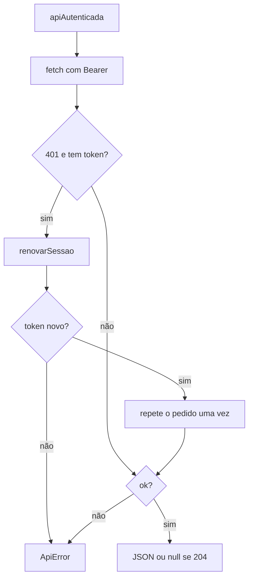

# Frontend: sessão, cliente HTTP e rotas

## 1. Stack

React 19, TypeScript, Vite, Tailwind 4, `react-router-dom` 7, Vitest para testes. A URL da API vem de `VITE_API_URL`.

## 2. Estrutura de `Frontend/src`

| Pasta | Conteúdo |
|---|---|
| `pages/` | Uma tela por rota (`Home`, `Receitas`, `Recipe`, `NovaReceita`...) |
| `components/` | Peças reutilizáveis (`Header`, `RecipeCard`, `Protegida`, `Comentarios`...) |
| `api/` | Chamadas ao backend por assunto (`auth`, `receitas`, `diretorio`...) |
| `context/` | `Auth.tsx`: estado global de login |
| `lib/` | Utilitários (`validar`, `mascaras`, `format`, `useForm`) |
| `hooks/` | `useLocalState` (estado salvo no navegador) |

## 3. Cliente HTTP (`api/http.ts`)

Todas as chamadas autenticadas passam por `apiAutenticada`:

- **`ApiError(mensagem, status)`**: erro padrão. `status 0` significa rede, CORS ou servidor fora do ar.
- **`mensagemDeErro`**: usa o campo `mensagem` do backend; se faltar, cai numa mensagem por status (400, 401, 403, 404, 409).
- Em desenvolvimento, falhas são logadas com o tempo restante do token.

## 4. Sessão (`context/Auth.tsx`)

- O **access token** fica só em memória (estado React).
- O **refresh token** fica no `localStorage` (`gm-refresh-token`) e é **rotacionado** a cada uso.
- Ao abrir o site, se existe refresh, o `AuthProvider` tenta renová-lo. Enquanto isso, `carregando = true`.
- **Renovações simultâneas** dividem a mesma `Promise` (`renovando`), para não rotacionar o refresh duas vezes.
- Sem conexão (status 0): mantém a sessão. Refresh recusado: limpa a sessão.
- `cadastrar` cria a conta e depois chama `entrar`, porque o cadastro não devolve tokens.
- `sair` avisa a API, mas limpa localmente mesmo se ela falhar.

## 5. Rotas protegidas (`Protegida.tsx`)

Envolve páginas privadas. Se `carregando`, mostra esqueleto. Se não há usuário, redireciona para `/login` guardando o destino em `state.from`.

## 6. Rotas principais (`App.tsx`)

| Rota | Tela |
|---|---|
| `/`, `/receitas`, `/receita/:id` | Descoberta e receita |
| `/publicar`, `/receita/:id/editar` | Publicar e editar (profissional) |
| `/profissionais`, `/restaurantes`, `/chef/:id` | Diretório |
| `/login`, `/cadastro`, `/onboarding` | Entrada e cadastro profissional |
| `/favoritos`, `/conta`, `/perfil`, `/painel` | Área do usuário |
| `*` | `NotFound` |

## 7. Decisões e trade-offs

- **Refresh no `localStorage`:** simples e sobrevive ao fechar a aba, mas fica exposto a XSS. Access em memória reduz o dano.
- **Um único renovador compartilhado:** evita corrida entre pedidos paralelos.
- **Leitura pública sem login:** o cliente funciona com `token = null`.

## 8. Erros comuns

- Esquecer `VITE_API_URL` no `.env`.
- Erro de CORS: a origem do front precisa estar em `app.cors.allowed-origins` no backend.
- Mostrar conteúdo privado antes do `carregando` terminar.

## 9. Perguntas de consolidação

1. Por que o access token não vai para o `localStorage`?
2. O que impede dois refreshes ao mesmo tempo?
3. O que significa `ApiError` com `status 0`?
4. Para onde o usuário volta depois do login?
