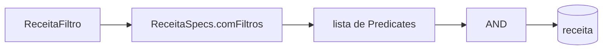

# Receitas: busca com filtros, porções e nutrição

## 1. Busca com filtros (`ReceitaSpecs`)

A listagem usa **Specification** (Spring Data JPA): uma consulta montada em tempo de execução, conforme os filtros enviados (`ReceitaFiltro`). Só entra na consulta o filtro que veio preenchido.

| Filtro | Regra |
|---|---|
| `texto` | `nome` ou `descricao` contém o texto, sem caixa nem acento |
| `tempoMax` | `tempoPreparo <= valor` (minutos) |
| `dificuldade`, `tipo`, `ocasiao`, `perfil`, `metodo` | Igualdade com o enum |
| `ingredientes` | "O que tenho na geladeira" (ver abaixo) |



### Texto sem acento

`unaccent(lower(nome)) LIKE padrao`. O padrão também chega sem acento (`BuscaTexto`), com escape de `%`, `_` e `\` para o usuário não injetar curingas.

### "Ingredientes que tenho"

A receita aparece se:
1. tem **ao menos um** ingrediente; e
2. **não existe** nenhum ingrediente dela fora da lista informada.

São duas subconsultas (`EXISTS` e `NOT EXISTS`).

## 2. Ajuste de porções (`CalculoReceita`)

```
quantidadeNova = quantidade x porcoesDesejadas / porcoesDaReceita   (2 casas)
```

Exemplo: 200 g para 4 porções, pedindo 6 → `200 x 6 / 4 = 300 g`.

## 3. Tabela nutricional

Para cada ingrediente:

```
fator = quantidade / porcaoBase
calorias += fator x calorias do ingrediente   (idem gordura, proteína, carboidrato)
```

- Soma a receita na quantidade original, divide pelas porções dela para obter **valor por porção**.
- O **total** vale para `porcoesDesejadas`; o valor por porção não muda.
- Só calcula unidades **G** e **ML**. Outras (ex.: unidade, colher) vão para `naoCalculados`, e a resposta indica que o cálculo está incompleto.
- Arredondamento: 1 casa nos valores nutricionais.
- A classe é só matemática: **sem banco**, fácil de testar.

## 4. Imagens (`ArmazenamentoService`)

Interface com duas implementações, escolhidas pelo `ArmazenamentoConfig`:

- `ArmazenamentoLocal`: disco do servidor, servido por `GET /imagens/{nome}`.
- `ArmazenamentoSupabase`: Supabase Storage, devolve o link completo.

O nome do arquivo é aleatório (32 hex + `jpg|png|webp`). Qualquer outro nome é recusado (`NOME_VALIDO`), o que bloqueia *path traversal*.

## 5. Erros comuns

- Esperar acento exato na busca (é ignorado de propósito).
- Ingrediente em unidade que não é G/ML: nutrição incompleta.
- Dividir por `porcoesDaReceita = 0` (a receita exige `nPorcoes` válido).

## 6. Perguntas de consolidação

1. Por que usar Specification em vez de vários métodos no repository?
2. Como a busca por ingredientes evita receitas com itens que o usuário não tem?
3. Por que o valor por porção não muda ao ajustar as porções?
4. Por que o nome do arquivo de imagem é validado por regex?
