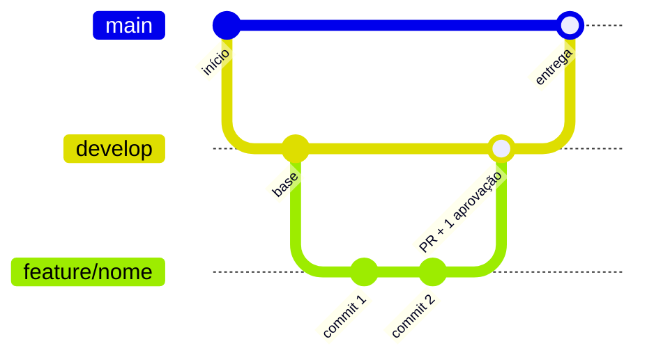

# GastroMatch

Plataforma gastronômica com receitas passo a passo, tabela nutricional, avaliações e perfis de chefs, nutricionistas e restaurantes. É o **Projeto Integrador II** (DevOps, Ciência de Dados e Computação em Nuvem).

## Acesso

| Ambiente | Endereço | Observação |
|---|---|---|
| AWS (demonstração) | <https://184-197-177-43.sslip.io> | disponível com o Learner Lab ligado |
| Vercel + Render (reserva) | <https://gastromatch-front.vercel.app> | a primeira chamada pode levar cerca de 1 minuto |
| Saúde da API na AWS | <https://184-197-177-43.sslip.io/api/actuator/health> | |

## O problema

Quem cozinha não sabe o valor nutricional nem se o preparo é confiável; quem publica não sabe o que o público ainda não encontra. Os dados do GastroMatch ajudam o **chef** a decidir **que receita publicar a seguir**.

## Funcionalidades

- Busca de receitas por texto e filtros, e pelos ingredientes que a pessoa tem
- Receita com etapas, dicas, erros comuns, vídeo do YouTube, ajuste de porções e modo cozinhar
- Tabela nutricional calculada a partir dos ingredientes (em g e ml)
- Cadastro, login, favoritos, comentários e notas
- Perfis de chef, nutricionista e restaurante; publicação de receitas e envio de imagens
- [Indicadores](docs/evidencias/indicadores.md): cobertura nutricional, oferta e avaliação por perfil alimentar

**Ainda não implementado:** fórum, kits, lista de compras e cardápio, mapa, feed de vídeos, painel de indicadores no site e tela de administração.

## Arquitetura

```text
Navegador --HTTPS--> EC2 (Caddy: front e /api) --> Spring Boot --> Supabase (banco e imagens)
GitHub (main, CI aprovado) <-- o EC2 consulta a cada 2 minutos e publica
```

- **Front:** React, TypeScript, Vite e Tailwind ([Frontend](Frontend/README.md))
- **API:** Java 21 e Spring Boot ([Backend](Backend/Readme.md))
- **Banco:** PostgreSQL ([scripts](Data/Modelagem))
- **Nuvem:** AWS EC2 com Docker ([roteiro](deploy/aws/README.md))

## Como rodar no seu computador

Precisa de Docker, Java 21 e Node 22.

```bash
# banco local
cd Backend
cp .env.example .env      # preencha DB_PASSWORD e JWT_SECRET
docker compose up -d
```

```bash
# API em http://localhost:8080 (no Windows: .\mvnw.cmd spring-boot:run)
./mvnw spring-boot:run
```

```bash
# front em http://localhost:5173
cd Frontend
cp .env.example .env.local   # use VITE_API_URL=http://localhost:8080
npm ci
npm run dev
```

Detalhes em [SETUP-BANCO.md](Backend/SETUP-BANCO.md).

## Testes e indicadores

| O que | Comando |
|---|---|
| Back (precisa do banco) | `cd Backend && ./mvnw test` |
| Front | `cd Frontend && npm run lint && npm run coverage` |
| Indicadores: testes | `node --test Data/indicadores/indicadores.test.mjs` |
| Indicadores: nova coleta | `node Data/indicadores/indicadores.mjs` |

## Evidências do projeto

| Evidência | Onde |
|---|---|
| Plano do projeto | [PDF](docs/plano-projeto-integrador-ii.pdf) e [fonte](docs/plano-projeto-integrador-ii.md) |
| Indicadores e dados | [relatório](docs/evidencias/indicadores.md), [amostra](Data/amostra/receitas.json), [script](Data/indicadores/indicadores.mjs) |
| Pipeline | [ci.yml](.github/workflows/ci.yml) e aba [Actions](https://github.com/GastroMatch-PI/GastroMatch/actions) |
| Implantação e recuperação | [deploy/aws](deploy/aws/README.md) |
| Falha analisada | [incidente de 27/11](docs/evidencias/incidente-2026-11-27.md) |

## Como Contribuir

O projeto segue um fluxo com duas branches permanentes e uma branch de trabalho por membro da equipe.

| Branch | Para que serve | Regras |
|---|---|---|
| `main` | Versão estável, usada nas entregas | Protegida: só recebe código via PR com 1 aprovação |
| `develop` | Integração do trabalho de todos | Protegida: só recebe código via PR com 1 aprovação |
| `feature/<nome>` | Trabalho individual de cada membro | Livre: push direto liberado |

Branches de cada membro: `feature/amos`, `feature/diogo`, `feature/fellipe`, `feature/gustavo` e `feature/vinicius`.



### Passo a passo

**1. Entre na sua branch** (ela já existe e saiu da `develop`):

```bash
git fetch origin
git switch feature/seu-nome
```

**2. Trabalhe e suba suas alterações** quantas vezes quiser:

```bash
git add .
git commit -m "feat: descrição do que foi feito"
git push
```

Antes de abrir o PR, traga as novidades da `develop` para resolver conflitos na sua branch:

```bash
git pull origin develop
```

**3. Abra um Pull Request para a `develop`**

- No GitHub, abra um PR com **base: `develop`** ← **compare: `feature/seu-nome`**.
- Um colega precisa revisar e aprovar (o autor não pode aprovar o próprio PR).
- Com a aprovação, faça o merge.

**4. Entrega**

Quando a `develop` estiver estável, abra um PR com **base: `main`** ← **compare: `develop`**, que também precisa de 1 aprovação.

### Importante

- A base do PR da sua feature é sempre a **`develop`**, nunca a `main`.
- Push direto na `main` ou na `develop` é recusado pelo GitHub.
- Depois do merge, continue usando a sua `feature/seu-nome`: rode `git pull origin develop` nela e siga para a próxima tarefa.
